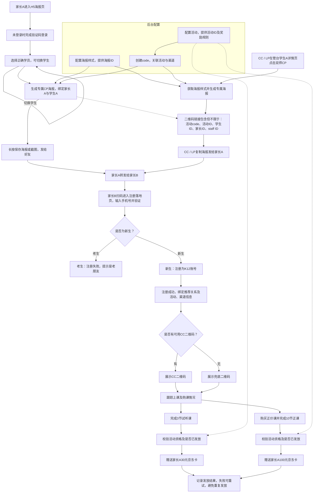

# VIPKID 优学——双师CP转介绍 PRD

| 项目 | 内容 |
|---|---|
| 产品名称 | VIPKID 优学 |
| 需求名称 | 双师CP转介绍活动 |
| 文档版本 | V1.1 |
| 文档日期 | 2026-10-30 |
| 目标终端 | 管台PC端、家长侧移动端H5、活动配置后台 |
| 需求状态 | 待评审 |

## 1. 需求背景

CC / LP需要在学生详情页生成专属转介绍海报，由家长A分享给家长B。家长B扫码后完成手机号验证和新老生判定，新生注册为K12账号，注册成功后展示CC二维码或兜底二维码。

系统需要贯通人员、推荐人、被推荐人、活动和渠道的关联信息，在家长B完成指定试听或正课要求时，为家长A发放京东卡奖励，并保留可追溯的达标与发放记录。

## 2. 产品目标

1. CC / LP可在管台学生A详情页点击“双师CP”，生成并复制专属海报；家长A也可通过H5选择学员后自主生成CP海报。
2. 后台可配置海报样式、活动及奖励规则，创建code以关联活动与渠道。
3. 家长B扫码注册为K12账号；老生不进入本次新生注册成功流程。
4. 记录CC / LP与家长A、家长A与家长B的关系，支持活动与渠道归因。
5. 家长B完成3节试听课后，赠送家长A30元京东卡；购买正价课并完成10节正课后，赠送家长A100元京东卡。
6. 奖励可查询、可追溯，重复事件不重复发放。

## 3. 非目标

- 本期不扩展多级推荐、下级分佣或排行榜。
- 本期不新建独立购课、排课和上课系统，复用现有业务能力及其结果数据。
- 本期未定义家长侧奖励中心、卡密展示或兑换页面；实际发放渠道需在评审中确认。
- 本文不将两档奖励可累计、推荐归属优先级等未确认规则视为已定需求，具体见第12章。

## 4. 用户角色与使用场景

### 4.1 用户角色

| 角色 | 职责 |
|---|---|
| CC / LP | 在学生A详情页生成海报并发送给家长A |
| 家长A | 推荐人，接收管台海报或通过H5自主生成海报，分享给家长B，满足条件后获得奖励 |
| 家长B | 被推荐人，扫码、注册K12账号、试听及购买正价课 |
| 运营人员 | 配置海报、活动、渠道code与奖励规则 |
| 系统 | 建立关联关系、判定达标、执行奖励发放并记录结果 |

### 4.2 核心场景

- CC / LP为当前学生家庭生成可追溯的转介绍海报。
- 家长B扫码后使用手机号注册，系统区分新老生。
- 注册成功后，家长B通过CC二维码或兜底二维码继续联系咨询。
- 家长B达标后，系统定位家长A并发放对应奖励。
- 运营按活动、渠道和人员查询注册、达标及奖励结果。

## 5. 信息架构

| 业务区域 | 一级模块 | 主要内容 |
|---|---|---|
| 配置后台 | 海报配置 | 样式、海报ID、预览 |
| 配置后台 | 活动配置 | 活动ID、奖励条件及奖励内容 |
| 配置后台 | code配置 | 创建code、关联活动、关联渠道 |
| 管台 | 学生A详情页 | 双师CP入口、海报预览及复制 |
| 家长H5 | CP海报生成页 | 验证码登录、选择/切换学员、生成及保存海报 |
| 家长H5 | 注册落地页 | 手机号验证、新老生判定、K12账号注册 |
| 家长H5 | 结果页 | 老朋友提示、CC二维码、兜底二维码 |
| 服务端及后台 | 关联与奖励记录 | 推荐关系、达标记录、发放状态及异常查询 |

### 5.1 核心流程

两条奖励分支表示不同达标条件，不代表已确认累计领取或互斥领取。

## 6. 页面需求

### 6.1 后台：海报样式配置

#### 页面目标

运营配置海报样式，管台根据海报ID获取对应样式并合成专属二维码。

#### 字段

| 字段 | 必填 | 说明 |
|---|---|---|
| 海报ID | 是 | 系统生成的唯一标识，供管台调用 |
| 海报名称 | 是 | 便于运营识别 |
| 海报样式资源 | 是 | 模板图片或模板资源 |
| 二维码区域 | 是 | 模板内二维码位置与尺寸 |
| 配置状态 | 是 | 建议支持启用、停用 |

#### 规则

- 支持保存和预览，二维码不得遮挡关键文案。
- 管台按海报ID获取样式；海报ID无效或样式不可用时提示生成失败并允许重试。
- 活动与海报样式的使用映射需明确，管台不要求CC / LP手工填写海报ID。

### 6.2 后台：活动配置

#### 页面目标

配置活动及达标奖励规则，向管台和奖励服务提供活动ID。

#### 字段

| 字段 | 必填 | 说明 |
|---|---|---|
| 活动ID | 是 | 系统生成的唯一标识 |
| 活动名称 | 是 | 活动业务名称 |
| 海报ID | 是 | 本活动使用的海报样式 |
| 活动状态 | 是 | 建议支持未开始、进行中、已结束、已停用 |
| 活动有效期 | 待确认 | 是否限制注册、达标或发奖时间，需分别确定 |
| 试听奖励 | 是 | 完成3节试听课，向家长A发30元京东卡 |
| 正课奖励 | 是 | 购买正价课并完成10节正课，向家长A发100元京东卡 |
| 兜底二维码 | 是 | 无可用CC二维码时展示的资源 |

#### 规则

- 达标条件与奖励内容绑定至活动ID。
- 奖励领取人为家长A，达标行为主体为家长B关联的有效学员，不能混淆。
- 建议记录规则版本；活动修改不能无记录地改变已绑定用户的适用规则。
- 活动结束后存量用户的达标和补发规则需在上线前确认。

### 6.3 后台：创建code，关联活动与渠道

#### 页面目标

创建code，将活动与渠道关联起来，用于扫码注册归因及后续统计。

#### 字段

| 字段 | 必填 | 说明 |
|---|---|---|
| code | 是 | 唯一标识；本文按前文二维码链接中的“活动code”处理 |
| 活动ID | 是 | code对应的活动 |
| 渠道ID / 渠道名称 | 是 | code对应的渠道 |
| 状态 | 是 | 建议支持启用、停用 |
| 创建人、创建时间 | 是 | 自动记录 |

#### 规则

- 建议一个code唯一对应一组活动与渠道；同一活动可按不同渠道创建多个code。
- 同一个code不能重复创建；活动或渠道无效时不可保存。
- code随海报链接传递，服务端据此解析并记录活动与渠道。
- 链接中的活动ID必须与code关联活动一致；不一致时不得静默使用任意一项完成归因。
- 已使用code建议不直接修改关联关系，避免历史海报归因发生漂移。
- 以上映射约束为实现建议，需在评审时确认。

### 6.4 管台：学生A详情页“双师CP”入口

#### 页面目标

CC / LP在当前学生上下文中生成专属海报。

#### 新增元素

| 元素 | 展示 | 交互 |
|---|---|---|
| 双师CP | 按钮 | 点击生成并预览海报 |
| 海报预览 | 配置样式与专属二维码 | 展示完整海报 |
| 复制海报 | 按钮 | 复制成功后由CC / LP自行发送给家长A |

#### 规则

- 入口位于学生A详情页，不增加“选择活动与家长A”作为必经操作。
- 学生ID取当前学生A；家长ID取对应家长A；staff ID取当前生成海报的CC / LP登录身份。
- 记录CC / LP与家长A的关系，同时记录学生A及本次海报生成信息。
- 活动、code和海报样式根据有效配置获取；存在多项可用配置时，使用规则需确认。
- 学生与家长关系存在歧义时不得静默选择；需明确主家长规则或提示处理。
- 复制中禁止重复触发；收到成功结果后提示“海报已复制”。失败时提示重试，不显示虚假成功。
- 家长A自行将海报转发给家长B，系统不将“生成成功”或“复制成功”等同于“实际转发成功”。

#### 二维码链接参数

| 业务字段 | 建议参数名 | 来源与含义 |
|---|---|---|
| 活动code | `activity_code` | 关联活动与渠道的code |
| 活动ID | `activity_id` | 当前活动 |
| 学生ID | `student_id` | 学生A |
| 家长ID | `parent_id` | 推荐人家长A |
| staff ID | `staff_id` | 生成海报的CC / LP |

- 链接包含但不限于以上字段，可补充海报ID、来源记录ID、签名等；技术字段命名由研发统一。
- 注册前持续保留来源上下文；发送验证码、刷新或提交注册不得丢失推荐信息。
- 参数由服务端校验，不以用户修改后的URL参数直接决定推荐归属和奖励领取人。

### 6.5 家长侧：注册落地页

#### 页面目标

家长B验证手机号，完成新老生判定，新生注册为K12账号。

#### 页面结构与字段

| 元素 | 必填 | 交互与说明 |
|---|---|---|
| 手机号 | 是 | 输入手机号，校验格式 |
| 短信验证码 | 是 | 输入验证码 |
| 获取验证码 | — | 校验手机号后发送，按短信服务规则倒计时和防重复发送 |
| 免费注册 | — | 校验表单和必要授权后提交 |
| 孩子年龄 | 待确认 | 参考表单素材包含此字段，是否纳入及选项范围尚未确认 |
| 协议与隐私说明 | 按K12现有规范 | 复用现有注册授权流程 |

#### 注册流程

1. 扫码进入落地页，校验海报来源参数与活动配置。
2. 家长B输入手机号并完成短信验证。
3. 服务端按统一口径判定新老生，具体判定范围见第12章。
4. 老生：本次注册不成功，提示“您已经是老朋友啦”；不创建新K12账号，不新增本次新生推荐关系。
5. 新生：调用K12注册能力创建账号，不得仅创建活动线索并提示注册成功。
6. K12注册成功后，记录家长B账号与推荐关系，关联活动、渠道及来源人员。
7. 进入注册成功页，获取并展示CC二维码；没有可用CC二维码时展示兜底二维码。

#### 状态规则

- 验证码错误、过期或网络失败时保留已输入信息，提示修正或重试。
- 注册提交期间按钮显示加载态并禁止重复提交。
- 建议为同一次注册建立幂等标识；重复请求返回一致结果，避免已成功用户因重试被错误提示为老生。
- 账号创建成功但推荐关系写入失败时，记录待补偿任务，不重复创建账号，不丢失来源数据；最终一致性方案需研发确认。
- 注册失败不展示注册成功页，不进入本次推荐奖励链路。

### 6.6 家长侧：注册结果页

#### 页面目标

明确告知注册结果，并为新生提供后续联系入口。

| 场景 | 展示 | 规则 |
|---|---|---|
| K12注册成功且CC二维码可用 | 注册成功提示、CC二维码 | 二维码完整清晰，配套联系说明 |
| K12注册成功但CC二维码不可用 | 注册成功提示、兜底二维码 | 不影响已建立的账号及推荐关系 |
| 判定为老生 | “您已经是老朋友啦” | 不展示新生注册成功状态 |
| 两类二维码均加载失败 | 注册成功提示、重试入口及联系失败提示 | 保持注册成功事实，不要求重新注册 |

- CC二维码的人员选取规则需确认，不能默认等同于链接中的staff ID，特别是由LP生成海报的场景。
- 二维码展示不等于用户已添加CC，不以是否扫码添加作为现有奖励条件。

### 6.7 关联关系与奖励记录

#### 页面目标

为运营核对推荐来源、达标和奖励发放情况提供记录；具体后台入口可复用现有能力。

#### 关联信息

| 关系 | 需记录内容 |
|---|---|
| CC / LP与家长A | staff ID、角色、家长A ID、学生A ID、来源记录ID、生成时间 |
| 家长A与家长B | 推荐关系ID、家长A ID、家长B ID、K12账号ID、绑定时间 |
| 推荐关系与活动渠道 | 活动ID、code、渠道ID、海报ID、适用规则版本 |
| 家长B与达标数据 | 家长B关联学员ID、有效课次、有效购课订单、达标时间 |
| 推荐关系与奖励 | 奖励档位、金额、领取人、发放状态、发放流水号、失败原因 |

- 学生A、家长A与家长B关联学员须使用不同字段，不得将学生A的上课数据用于判定家长B达标。
- 需明确家长B的K12账号对应哪个有效学员；多学员家庭的课次累计口径待确认。
- 历史推荐关系保留建立时的人员来源；人员调岗后是否变更业务归属，另行确认。

#### 奖励规则

| 奖励档位 | 达标条件 | 领取人 | 奖励内容 |
|---|---|---|---|
| 试听奖励 | 家长B完成3节试听课 | 家长A | 30元京东卡 |
| 正课奖励 | 家长B购买正价课，并完成10节正课 | 家长A | 100元京东卡 |

- 服务端基于有效订单和课程完成结果判定，不依赖页面点击或前端累计数。
- 以唯一课次记录去重；重复回调不得增加完成课次数量。
- 未完成、取消、缺席等课次是否计入，以评审后确认的“完成课次”口径为准。
- 正课奖励必须同时满足“购买正价课”和“完成10节正课”；赠课、体验包或仅下单未支付不能直接认定为有效正价购课。
- 达标后先校验活动资格和发放记录，再触发奖励服务。
- 建议以“活动ID＋推荐关系ID＋奖励档位”保证发放幂等；若限制按被推荐账号领取一次，应再增加对应唯一约束。
- 发放超时或结果未知时先查询原流水，确认结果后再重试，避免重复发卡。
- 发放状态建议包含待发放、发放中、已发放、发放失败、结果待确认；未达标属于资格状态，不能标为发放失败。
- 奖励实际送达方式、发放时效、补发权限及两档累计规则见第12章。

### 6.8 家长侧：H5自主生成CP海报

#### 页面目标

家长A可直接进入H5，登录并选择正确学员，自主生成专属CP海报，保存或截图后发送给家长B；与CC / LP管台生成并行，后续注册、推荐绑定及奖励链路一致。

#### 参考页面及核验范围

- 参考页面：[邀请海报](https://mobile.vipkid.com.cn/parentsspeedy/extend/tanmaposter)。
- 核验日期：2026-10-30；环境：普通浏览器、未登录状态。
- 已观察页面标题、待生成态、选择学生入口、点击后验证码登录层及页面分享指引。
- 未完成登录，未实测学员列表、已登录自动生成、切换学生控件实际位置、生成完成样式、长按保存结果及二维码落地参数。下文区分“页面已确认”与“本期补充需求”，不将未验证逻辑描述为现网事实。

#### 页面已确认的逻辑

| 页面元素 / 场景 | 已观察内容 | 逻辑说明 |
|---|---|---|
| 页面标题 | 邀请海报 | 用于家长侧邀请海报生成 |
| 待生成态 | “您的海报正在定制中...”及配图 | 未选择学生时仍展示该占位文案，不能据此认定生成请求已成功执行 |
| 主入口 | “请先选择学生生成海报” | 生成海报前需先确定学员 |
| 点击主入口 | 弹出“验证码登录”层 | 当前未登录访问需要先登录 |
| 登录层 | 两个输入框、“获取验证码”“立即登录” | 验证码登录；空表单下获取验证码按钮为禁用状态 |
| 登录协议 | VIPKID用户协议、隐私协议、儿童隐私保护政策 | 登录层展示同意说明及三个协议链接；默认勾选和提交校验未验证 |
| 学员提醒 | “请先选择正确的学员账号再分享” | 分享前需确认学员归属 |
| 切换指引 | 可点击页面右上角“切换学生”重新选择 | 页面文案确认该能力；当前未登录视图未验证实际控件 |
| 分享指引 | “请长按保存海报”或“截图发给好友” | 以海报图片为主要传播载体 |
| 好友参与 | “好友扫码即可参与活动” | 家长B扫描海报二维码进入活动 |
| 特别提醒 | “直接转发此页面无法识别哦” | 不能以生成页URL直接转发替代专属海报分享 |

#### 本期补充需求：进入、登录与学员选择

1. 家长A进入H5海报生成页，页面获取有效活动、渠道code及海报模板配置。
2. 未登录时，点击生成入口打开验证码登录层；登录成功后回到原活动上下文，继续学员选择，不能丢失活动与渠道信息。
3. 登录复用现有家长账号体系，不以家长B的新生K12注册流程替代家长A登录。
4. 展示当前账号有权访问的学员，生成前明确当前学生A；学员列表字段、排序和单学员是否自动选择需评审确认。
5. 无关联学员时提示“暂无可选择的学员”，不生成虚构学生身份的海报。
6. 家长A可通过“切换学生”重新选择；切换后重新生成对应学员的专属海报。
7. 切换过程中禁止继续保存上一学员的旧海报；失败时保留清晰的当前学员及错误状态，允许重试。

#### 本期补充需求：生成与来源关联

| 字段 | H5自主生成取值 / 处理 |
|---|---|
| 家长ID | 当前登录并校验通过的家长A ID |
| 学生ID | 家长A选中的学生A ID，校验与家长的关联权限 |
| 活动ID、活动code | 有效配置，code关联活动与渠道 |
| staff ID | 从现有归属关系按确认后的规则解析；不能伪造为当前操作人员 |
| 生成来源 | 新增来源类型，建议 `console`（管台）、`parent_h5`（家长H5） |
| 海报及来源记录 | 海报ID、生成记录ID、生成时间、关联身份快照 |

- 二维码链接继续包含活动code、活动ID、学生ID、家长ID、staff ID等约定信息；H5场景无staff归属时如何满足字段约定，需明确缺省及兜底方案，不静默丢失。
- H5生成记录中的实际操作人为家长A，人员归属为关联的CC / LP，两者分别记录。
- 家长A自主生成不代表CC / LP执行了生成操作；有有效归属时记录CC / LP与家长A的关系。
- 只有家长B成功注册后才建立家长A与家长B的推荐关系；生成、保存海报不建立被推荐人关系。
- 生成成功后展示完整海报及当前学员身份，二维码保持清晰可扫描。
- staff归属解析失败不应无提示地形成错误归因；具体阻断还是允许兜底生成由评审确认。

#### 本期补充需求：保存、分享与恢复

- 海报完成后提供“长按保存海报”及“截图发给好友”指引；支持方式以微信和浏览器实际能力为准。
- 明确提示“直接转发此页面无法识别，请保存海报或截图发给好友”。
- 截图应覆盖完整海报及二维码，二维码不能被弹层、按钮或裁切遮挡。
- 不将海报曝光、长按或保存操作等同于实际分享成功；普通H5无法确认系统保存结果时不误报“已保存”。
- 家长B扫码后进入已有手机号验证、新老生判定及K12账号注册流程；奖励仍发给家长A。
- 刷新、登录中断后重新核验身份和学员权限，再恢复或重新生成；不得将其他账号的历史海报展示给当前账号。
- 待选择、生成中、生成失败、生成成功应分别展示；本期不沿用永久“定制中”掩盖失败状态。

## 7. 页面与设备适配要求

- 管台及配置后台适配PC浏览器；家长侧H5优先适配手机竖屏。
- 表单不产生横向滚动，软键盘弹出后当前输入项和提交操作可访问。
- 页面主要按钮与输入框具备足够点击热区，按钮加载时保留可读反馈。
- 海报及二维码保持比例，不能拉伸、裁切或被遮挡；以实际扫码验证可识别性。
- 兼容微信内置浏览器及主流手机浏览器，具体支持版本由研发确认。
- 复制海报能力按浏览器实际支持验证，降级方式在评审中明确，不将下载误报为复制成功。

## 8. 数据与接口建议

以下接口为能力建议，路径与字段由研发结合现有服务统一，不代表已有接口。

### 8.1 配置读取

`GET /api/v1/cp/config?studentId={studentAId}`

返回可用活动ID、code、海报ID和必要配置；服务端验证当前staff访问学生的权限。

### 8.2 海报生成

`POST /api/v1/cp/posters`

管台输入学生A ID及必要业务上下文，staff ID以服务端人员登录身份为准。H5自主生成时以家长A登录态校验学生权限，staff ID从已确认的人员归属规则解析；增加生成来源字段，不能要求家长登录态提供人员身份。返回海报、来源记录ID及二维码链接，记录CC / LP与家长A的关系。

### 8.3 落地页来源解析

`POST /api/v1/cp/sources/resolve`

校验code、活动ID、学生ID、家长ID、staff ID及签名，返回有效来源上下文，不向H5暴露无关个人信息。

### 8.4 手机号验证与K12注册

复用现有短信及K12注册服务，通过统一业务编排完成新老生校验、K12账号注册和推荐关系绑定。返回注册结果、K12账号标识、推荐绑定状态与结果页信息。

### 8.5 结果页二维码

`GET /api/v1/cp/registrations/{registrationId}/contact-qrcode`

返回CC二维码或兜底二维码，并标识二维码类型；校验查询权限，不能通过任意账号ID查询。

### 8.6 达标事件与奖励发放

- 接入试听完成、正课完成及正价订单支付等现有服务事件。
- 事件包含唯一事件ID、学员ID、课程记录ID或订单ID、完成状态和业务发生时间。
- 根据推荐关系匹配适用活动，累计有效课次、判定达标，生成唯一奖励流水并调用发放服务。
- 对乱序事件执行重新核验，不能因正课事件先于订单事件到达而永久漏发。

### 8.7 通用接口规则

- 关键关联、资格判断与奖励计算由服务端负责。
- 金额以最小货币单位传输：30元为3000分，100元为10000分。
- 时间使用带时区的ISO 8601格式，业务展示按北京时间。
- 注册、关系绑定和奖励发放分别保证幂等，保留业务流水与错误码。
- 联系方式、账号与京东卡凭证按现有权限体系控制，埋点不包含手机号明文、验证码或卡密。

## 9. 加载、空态与异常处理

| 场景 | 产品表现 |
|---|---|
| 未登录点击H5生成入口 | 打开验证码登录层，保留活动及渠道上下文 |
| H5账号无关联学员 | 展示无可选学员提示，不生成海报 |
| H5切换学生 | 清除旧海报可保存状态，重新生成 |
| H5登录失效 | 提示重新登录，登录完成后重新校验学生权限 |
| 海报生成中 | 展示加载态，禁止重复生成 |
| 活动或模板不可用 | 提示“暂无可用活动”或“海报生成失败，请重试” |
| code缺失、无效或与活动不匹配 | 提示链接异常，不建立错误推荐关系 |
| 手机号格式错误 | 就近提示修正，不发送验证码 |
| 验证码错误或过期 | 提示重新输入或重新获取 |
| 老生 | 提示“您已经是老朋友啦” |
| K12注册服务失败 | 保留表单与来源上下文，允许重试 |
| 注册成功但绑定异常 | 保留注册事实，记录来源并进入补偿处理 |
| CC二维码不可用 | 展示兜底二维码 |
| 兜底二维码也不可用 | 展示注册成功与二维码重试入口 |
| 奖励发放失败 | 记录失败原因，按确认后的重试规则处理 |
| 奖励发放结果未知 | 查询原流水，确认前不新建另一笔发放 |
| 登录过期或无权限 | 管台提示重新登录或无操作权限 |

## 10. 埋点需求

| 事件 | 触发时机 | 关键参数 |
|---|---|---|
| `cp_parent_poster_view` | 家长H5海报页曝光 | 活动ID、code、生成来源 |
| `cp_parent_login_result` | 家长登录返回结果 | 活动ID、结果、错误码 |
| `cp_student_select` | 选择或切换学生 | 学生A ID、操作类型、生成来源 |
| `cp_poster_save_intent` | 可观测的保存入口操作 | 来源记录ID、生成来源、操作方式；不代表实际保存成功 |
| `cp_entry_click` | 点击双师CP | 学生A ID、staff ID |
| `cp_poster_generate_result` | 海报生成完成 | 来源记录ID、活动ID、code、海报ID、生成来源、结果、错误码 |
| `cp_poster_copy_result` | 复制操作完成 | 来源记录ID、结果、错误码 |
| `cp_landing_view` | 注册落地页有效曝光 | 来源记录ID、活动ID、code、渠道ID |
| `cp_sms_send_result` | 验证码发送返回 | 来源记录ID、结果、错误码 |
| `cp_register_submit` | 提交注册 | 来源记录ID、活动ID |
| `cp_register_result` | 注册编排返回 | 新生/老生、注册结果、绑定结果、错误码 |
| `cp_relation_bind_result` | 推荐关系建立或补偿完成 | 推荐关系ID、活动ID、渠道ID、结果 |
| `cp_contact_qr_view` | 联系二维码有效曝光 | 注册记录ID、二维码类型 |
| `cp_reward_qualified` | 服务端确认达标 | 推荐关系ID、奖励档位、达标时间 |
| `cp_reward_issue_result` | 奖励发放结果确认 | 奖励流水号、档位、金额、状态、错误码 |

转发行为无可靠回传时不埋“转发成功”；转化和发奖统计以服务端去重业务记录为准。

## 11. 验收标准

### 11.1 后台与海报

- [ ] 可配置海报样式并生成海报ID，管台按ID获取正确样式。
- [ ] 可配置活动ID及两档奖励规则。
- [ ] 可创建code并关联活动与渠道。
- [ ] 学生A详情页可点击“双师CP”生成海报。
- [ ] 二维码链接包含活动code、活动ID、学生A ID、家长A ID、staff ID。
- [ ] 记录CC / LP与家长A的关系，人员来源准确。
- [ ] 复制成功与失败反馈准确，生成海报可被手机扫码。

### 11.1.1 家长H5自主生成海报

- [ ] 未登录点击生成入口，展示验证码登录层及协议链接。
- [ ] 登录后保留原活动、渠道上下文，并选择正确学生。
- [ ] 无关联学生、登录失效、生成失败均有明确反馈。
- [ ] 切换学生后海报和二维码使用新学生身份，旧海报不可误保存。
- [ ] H5生成来源与管台可区分，实际操作人和staff归属分别记录。
- [ ] 展示长按保存、截图分享及不能直接转发页面的提醒。
- [ ] 海报可扫码进入注册落地页，推荐人仍为家长A。
- [ ] 登录后列表、生成结果及保存能力需使用有效测试账号补充验证。

### 11.2 注册与关系绑定

- [ ] 家长B扫码可进入正确落地页，表单交互不丢失来源信息。
- [ ] 手机号及验证码校验通过后，按统一口径识别新老生。
- [ ] 新生实际创建K12账号，成功后绑定家长A与家长B的推荐关系。
- [ ] 老生注册失败并提示是老朋友，不创建重复账号或新增本次新生推荐关系。
- [ ] 重复注册请求不会重复创建账号或错误覆盖推荐关系。
- [ ] 活动与渠道归因和code配置一致。
- [ ] 注册成功后展示CC二维码，无可用CC二维码时展示兜底二维码。
- [ ] LP生成海报场景按确认后的CC选取规则执行。
- [ ] 注册成功但绑定异常可追溯并补偿，不重复注册。

### 11.3 达标与奖励

- [ ] 未完成3节有效试听课时不触发试听奖励；完成后触发30元京东卡。
- [ ] 仅购课或仅完成正课均不触发正课奖励；购买正价课并完成10节有效正课后触发100元京东卡。
- [ ] 奖励领取人为家长A，课次取家长B关联有效学员的数据。
- [ ] 同一课次和重复事件不重复累计，同一奖励不重复发放。
- [ ] 乱序事件最终可正确核验达标。
- [ ] 发放失败、超时和未知结果有可追溯记录及处理机制。
- [ ] 两档累计、归属冲突、退款、有效期等规则确认后补充对应边界验收用例。

### 11.4 适配与数据

- [ ] PC管台及手机H5无关键内容遮挡或横向溢出。
- [ ] 微信内置浏览器和约定的主流浏览器可完成注册。
- [ ] 参数篡改不能更改奖励领取人或建立无效关系。
- [ ] 关键埋点覆盖生成、注册、绑定、达标与发奖，且不含敏感凭证。

## 12. 上线依赖与风险

### 依赖

- 管台学生、家长、staff身份与权限能力。
- 海报模板配置、二维码生成及复制能力。
- 活动、渠道与code配置服务。
- 手机短信、新老生判定及K12账号注册服务。
- 推荐关系存储与补偿能力。
- CC二维码及兜底资源获取能力。
- 试听/正课课次、正价课程订单数据及事件服务。
- 京东卡库存、实际送达渠道、发放查询及异常处理能力。

### 待确认事项

| 事项 | 需明确的决策 |
|---|---|
| H5人员归属 | 自主生成时staff ID取当前CC、LP还是其他归属；无staff时是否阻断及如何兜底 |
| H5学员选择 | 单学员是否自动选中，多学员字段、排序及默认选中规则 |
| H5登录后验证 | 使用有效测试账号确认学生列表、切换入口、生成结果及保存兼容性 |
| 新老生判定 | 按K12账号、全业务账号、历史线索还是历史购课判定；已有其他业务账号如何处理 |
| code含义 | 新增code是否统一使用“活动code”字段；是否一个code唯一关联一组活动与渠道 |
| 活动自动获取 | 同时存在多个有效活动或code时，学生详情页采用哪项配置 |
| 家长A选取 | 学生A关联多个家长时如何确定推荐人及领取人 |
| 推荐归属 | 家长B被多位家长推荐时，按首次扫码、首次有效注册或其他规则归属 |
| 自推荐 | 家长A与B为同一手机号或同一家庭时是否允许参与 |
| CC二维码 | CC / LP生成海报时分别选用谁的CC二维码，人员离职或调岗如何处理 |
| 完成课次 | 有效试听/正课的状态、课程范围、补课与重复上课的计数口径 |
| 家长B多学员 | 按一个指定学生累计，还是允许家庭内多名学生累计 |
| 正价课范围 | 商品及订单类型、支付成功口径、赠课是否计入10节正课 |
| 两档奖励 | 30元与100元是否可累计领取；是否存在每人、每活动奖励上限 |
| 活动有效期 | 注册、购课、完成课次、达标和发放分别受何种时间限制 |
| 退款退课 | 达标前后退款是否影响资格，已发奖如何处理 |
| 奖励送达 | 卡密、兑换链接或现有权益渠道；送达对象、通知方式及发放时效 |
| 异常补发 | 自动重试次数、间隔、人工补发权限及审批要求 |
| 年龄字段 | 是否纳入注册表单、是否必填及选项范围 |

### 风险

- 新老生判定与K12账号体系口径不一致，可能导致重复账号或误拒绝。
- 来源参数丢失或可被篡改，会造成推荐和渠道归因错误。
- 注册与关系绑定跨服务，需设计补偿，避免成功注册但推荐关系漏记。
- 课程与订单事件延迟、乱序或重复，可能导致漏发或重复发奖。
- 奖励服务超时不等于发放失败，盲目重试会重复消耗京东卡。
- 活动、code或人员关系直接修改，可能使历史归因发生漂移，建议保留历史快照。

## 13. 后续规划

- 根据运营需要扩展推荐进度、奖励明细与家长侧查询入口。
- 增加按活动、渠道、CC / LP维度的转化分析。
- 按实际运营情况完善异常处理、库存预警与奖励对账能力。
- 在规则明确后支持更多活动模板和奖励类型。

### 本次修订记录

| 版本 | 日期 | 修订内容 |
|---|---|---|
| V1.1 | 2026-10-30 | 参考邀请海报H5，新增家长自主生成入口、登录及选择/切换学员、图片分享指引、生成来源归因；更新流程图、异常、接口建议、埋点与验收；标注登录后未验证范围 |

